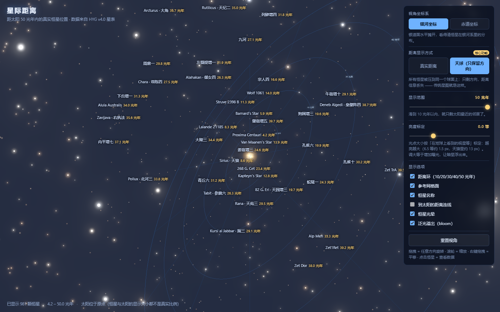
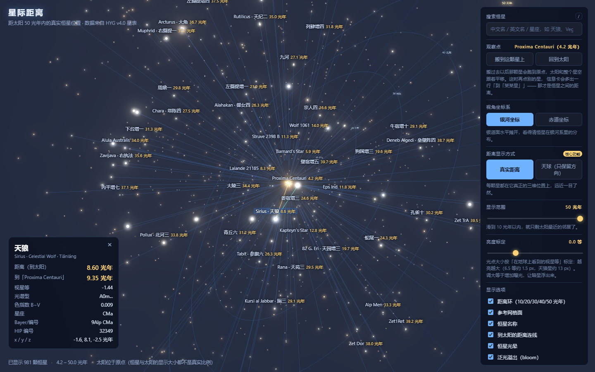
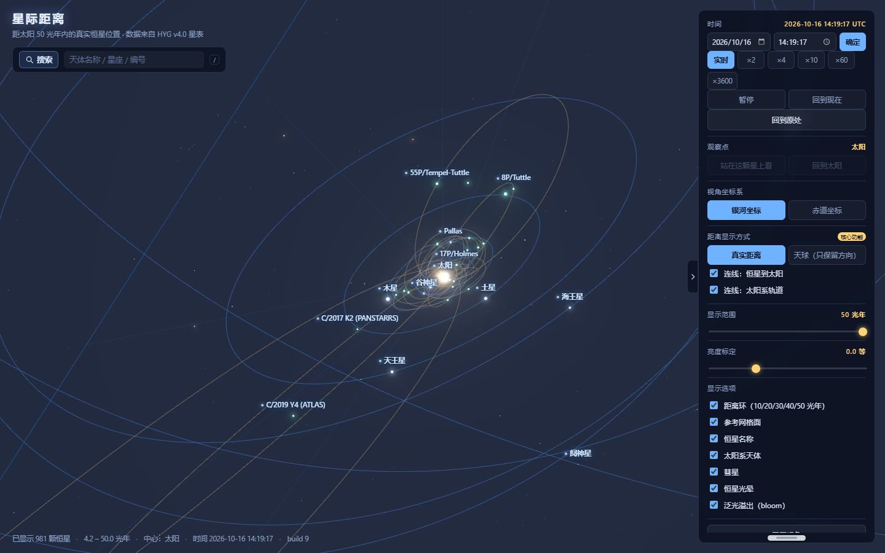
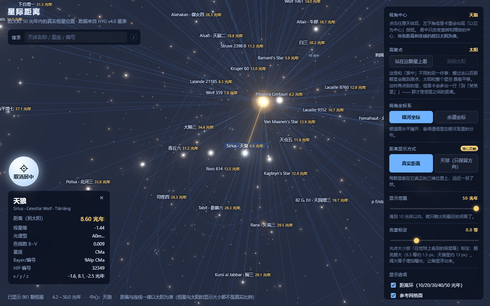

# 星际距离 · Interstellar Distance

An interactive 3D star map that places nearby stars at their **real distances** from the Sun,
instead of projecting every star onto a celestial sphere.


*The same 981 stars inside 50 light years, pushed onto one sphere — direction only, exactly what a
traditional star map shows:*



---

## What it does

The core feature is a single toggle that makes the point of the project visible:

| Mode | What it shows |
| --- | --- |
| **True distance** (default) | Every star sits at its real 3D position, so near and far are obvious |
| **Celestial sphere** | Only the direction is kept — every star is pushed onto one sphere |

Other controls:

- **Viewing frame**: galactic coordinates (the galactic plane laid out horizontally) or equatorial coordinates
- **Range slider**: 5 – 50 light years
- **Brightness**: point size is calibrated by apparent magnitude (mag 6.5 ≈ 1.5 px, Sirius ≈ 13 px) with a
  glow halo and a bloom pass; an exposure slider from −2 to +5 magnitudes brings faint stars up
- **Observer**: stand on any star and look back at the Sun — the info card then also reports the distance
  between that star and the one you click
- **Centre on any body**: pick a star and press *以它为中心* to orbit around it — distances stay Sun-based
- **Search**: in the top-left menu bar, by Chinese name, English name, Bayer/Flamsteed designation or
  constellation (`/` focuses it, ↑/↓ + Enter navigates)
- **Display options**: distance rings (10/20/30/40/50 ly), reference grid plane, star names, distance lines,
  star halo, bloom
- **Click any star** to inspect its data: Chinese and English name, constellation, spectral type, distance, magnitude

Camera: drag = rotate, wheel = zoom, right-drag = pan, click = select a star, Esc = deselect.



---

## Why this project

Two well-made existing tools both lose the thing I care about:

- **`three-starmap`** (npm): takes 8,912 naked-eye stars and projects **all of them onto a sphere of radius exactly 200.0**
  (verified in `tools/verify_three_starmap.py`: min = median = max = 200.0). Only the direction survives — the distance is gone.
- **`d3-celestial`**: its catalogue has right ascension, declination, magnitude and colour index, but **no distance field at all**,
  so it can only draw a flat 2D sky map.

Both projects are still used here as data sources (Chinese star names and constellation lines come from `d3-celestial`),
but the 3D positions come from a catalogue that actually has distances.

---

## Data — no star position is invented or AI-generated

Main source: **HYG Database v4.0** by David Nash ([astronexus/HYG-Database](https://github.com/astronexus/HYG-Database)),
licence **CC BY-SA 4.0**. HYG is a merge of the Hipparcos, Yale Bright Star and Gliese/Jahreiss catalogues.

- 119,626 stars with position, distance, magnitude, colour index, spectral type and **pre-computed x/y/z coordinates** in parsecs
- 10,226 stars with a missing or unreliable distance (`dist >= 100000`, a placeholder) are dropped
  → **109,400 stars** with a usable distance remain
- Star names: 4,870 English / 3,056 Chinese traditional names from `d3-celestial`
- Constellation lines: 88 constellations, from `d3-celestial`

Full provenance, field definitions and processing notes: **[`data/README.md`](data/README.md)**.

### Validation (these numbers match published astronomy)

| Star | HYG distance (light years) | Accepted value |
| --- | --- | --- |
| Proxima Centauri | 4.227 | 4.24 |
| Rigil Kentaurus (α Cen A) | 4.321 | 4.37 |
| Barnard's Star | 5.948 | 5.96 |
| Sirius | 8.601 | 8.60 |
| Procyon | 11.462 | 11.46 |
| Altair | 16.730 | 16.73 |
| Vega | 25.045 | 25.04 |
| Arcturus | 36.717 | 36.7 |

Coordinate self-consistency check: `|catalogue radius − dist|` has a median of 0.00000 pc and a maximum of 0.0386 pc.

### Known limitations

1. **Distance error grows quickly with distance.** Parallax-based distances are good to about 1 % for nearby stars,
   but can be off by tens of percent beyond a few hundred light years (Betelgeuse is quoted anywhere between 400 and 650 ly).
2. This is therefore "all stars with a reliable distance estimate", not "all stars".
3. A few stars have no traditional Chinese name and fall back to a Bayer/Flamsteed or HIP identifier.
4. HYG was last updated in 2024. **Gaia DR3** would give better precision later.

---

## How to build the data

```bash
python tools/gunzip_hyg.py      # hygdata_v40.csv.gz -> hygdata_v40.csv
python tools/build_dataset.py   # -> data/processed/{stars.bin, named_stars.json, stats.json}
```

`build_dataset.py` drops the 10,226 stars without a valid distance and writes:

| Output | Size | Content |
| --- | --- | --- |
| `processed/stars.bin` | 2.09 MB | 109,400 stars × 5 float32 `[x, y, z, mag, ci]`, parsecs |
| `processed/named_stars.json` | 0.95 MB | 3,151 named stars (3,008 with a Chinese name), sorted by distance |
| `processed/stats.json` | 3 KB | statistics and the 20 nearest / 20 brightest checks |

---

## How to run the app

The app loads its data with `fetch()`, so it needs a local web server (opening `index.html` as a file will not work):

```bash
python -m http.server 8811 --directory web
# then open http://127.0.0.1:8811/
```

`web/vendor/` already contains a local copy of three.js r186, so the app needs **no network access and no
`npm install`** — it works offline.

### URL parameters (jump straight to a state, handy for sharing a specific view)

| Parameter | Example | Effect |
| --- | --- | --- |
| `frame` | `?frame=equatorial` | use equatorial coordinates |
| `mode` | `?mode=sphere` | start in celestial-sphere mode |
| `max` | `?max=10` | only stars within 10 light years |
| `lines` | `?lines=0` | hide the distance lines to the Sun |
| `glow` / `bloom` | `?glow=0` | turn the star halo or the bloom off |
| `gain` | `?gain=3` | brightness gain in magnitudes (+3 = more exposure) |
| `star` | `?star=Sirius` | select a star and open its info card |
| `from` | `?from=Proxima%20Centauri` | **stand on that star** and look back at the Sun |
| `center` | `?center=Sirius` | orbit around that star instead of the Sun |
| `q` | `?q=天狼` | pre-fill the search box |
| `t` | `?t=2030-06-01T00:00:00Z` | set the simulated time |
| `solar` | `?solar=1` | fly straight into the solar system |
| `bodies` | `?bodies=0` | hide the solar-system bodies |
| `orbits` | `?orbits=0` | hide the orbit lines |

For example: `http://127.0.0.1:8811/?center=Sirius&star=Sirius`

### Time and the solar system

The sidebar has a **time bar**: pick a date and clock (UTC, 1800–2050), press 确定, and the app runs
forward at real speed. Speed can be set to ×1 (real time), ×2, ×4, ×10, ×60 or ×3600, and there is a
pause button and a "back to now" button. The time only affects solar-system bodies — the nearest star is
4.2 light years away, which is 265,000 AU, so on any human timescale the stars do not move.

**Scale.** Neptune is 30 AU from the Sun and 1 light year is 63,241 AU, so the whole solar system is
about 0.0005 light years across — a fraction of a pixel in the 50-light-year view. The bodies are drawn
at their true positions and **fade in only when the camera is inside the solar system**; the 飞向太阳系
button (or the scroll wheel, or `?solar=1`) takes you there. The Sun's own marker shrinks with the camera
distance, because its glow sprite is 4 light years wide and would otherwise fill the screen.



### Sidebar

- **Collapse tab** on the sidebar's left edge: the arrow points at the screen edge when open and back at
  the screen when collapsed.
- **White bar at the bottom**: drag up or down to resize the sidebar height, from full height down to one
  third. It is clamped so it never leaves the viewport.
- **使用说明** at the end of the sidebar expands the in-app manual.


### Menu bar (top left)

The search lives in a menu bar under the title. Type a Chinese name, an English name, a Bayer/Flamsteed
designation or a constellation; matching bodies are listed underneath with their distance. Click one (or
use ↑/↓ and Enter) and the camera flies to it and it becomes the rotation centre. If the star is outside
the current range, the slider widens automatically to include it.

### Two different ways to change the viewpoint — they are not the same thing

| | What moves | What the distances mean |
| --- | --- | --- |
| **居中 / centre** — button in the info card | only the orbit pivot; the scene does not move | still **the distance from the Sun**, and the radial lines still start at the Sun |
| **观察点 / observer** — panel, "站在这颗星上看" | the whole scene is translated | the info card *adds* a second number: the distance to the star you are standing on |

Centring is for inspecting one star closely without losing the Sun-based picture. The observer control is
for asking "how far apart are these two stars?".



The centre button is the round blue-white control just above the star card. It reads 居中, and turns white
with 取消居中 when the star you are looking at is already the centre — click again to go back to the Sun.

### Standing on another star

The panel has an **观察点 / observer** control. Pick a star, press *"站在这颗星上看"*, and the whole
scene is translated so that star sits at the origin: the Sun and every other star move with it.

This is what makes star-to-star distances visible. Stand on Proxima Centauri, click Sirius, and the info
card adds a second number — **9.35 light years** — next to the usual 8.60 ly from the Sun. Verified
independently from the catalogue's RA/Dec/distance:

| Pair | 3-D distance | Check |
| --- | --- | --- |
| Proxima Centauri → Sirius | 9.345 ly | angular separation on the sky is 86.4° |
| Rigil Kentaurus (α Cen A) → Proxima Centauri | 0.188 ly | Proxima is bound to α Cen at ≈13,000 AU ≈ 0.2 ly |
| Sirius → Procyon | 5.262 ly | published ≈5.2 ly |
| Sirius → Barnard's Star | 14.397 ly | — |


---

## Publishing to GitHub (no `git` required)

Every path in the app is relative, so it also runs correctly when served from a sub-path such as
`https://<user>.github.io/<repo>/` — verified by serving the parent directory and loading the page from
`/project-star-map-3d/web/`.

This machine has no `git` binary, so `tools/push-to-github.mjs` talks to the GitHub REST API directly.
It builds **one commit** out of every tracked file (blob → tree → commit → ref) and pushes it:

```powershell
$env:GITHUB_TOKEN = "ghp_..."          # token with the "repo" scope
node tools/push-to-github.mjs --repo project-star-map-3d --public --dry-run   # preview first
node tools/push-to-github.mjs --repo project-star-map-3d --public
```

`--dry-run` prints exactly which files would be uploaded and which `.gitignore` skips — the 13 MB HYG
archive and the unpacked third-party packages are skipped, and `tools/` can fetch them again.

**Publishing the site itself.** GitHub Pages can only serve the repository root or `/docs`, and the site
lives in `web/`, so `.github/workflows/pages.yml` uploads `web/` as the Pages artifact. After the first
push, set **Settings → Pages → Source = "GitHub Actions"**; the site then appears at
`https://<user>.github.io/<repo>/`.

---

## Project structure

```
project-star-map-3d/
├── .github/workflows/    pages.yml — publishes web/ to GitHub Pages
├── web/                  front-end (three.js), runnable demo
│   ├── index.html        UI: coordinate frame, distance mode, range, brightness, options
│   ├── main.js           scene, star rendering, magnitude calibration, glow, bloom, picking
│   ├── style.css
│   ├── data/             processed data used by the app
│   └── vendor/           three.js r186 (local copy, so no CDN is needed)
├── docs/                 preview screenshots used by this README
├── tools/                data pipeline, verification and publishing
│   ├── gunzip_hyg.py     decompress the HYG catalogue
│   ├── build_dataset.py  build stars.bin / named_stars.json / nearby50.json / stats.json
│   ├── push-to-github.mjs  publish via the GitHub API (works without git)
│   └── verify_*.py       checks against published values
├── data/
│   ├── raw/              downloaded catalogues and packages (see .gitignore)
│   ├── processed/        build output
│   └── README.md         data provenance, processing, validation, limitations
├── plan.md               project plan and review
└── README.md             this file
```

---

## Team

| Real name | GitHub username | Role |
| --- | --- | --- |
| `[YOUR REAL NAME]` | [@Hnuetronstar](https://github.com/Hnuetronstar) | data pipeline, front-end, documentation |
| `[TEAMMATE]` | `[@username]` | `[role]` |

Class: `[YOUR CLASS]`

---

## Progress

- [x] Chose the direction: real distances instead of a celestial sphere
- [x] Collected and documented the data sources
- [x] Built and validated the data pipeline (109,400 stars, checked against published distances)
- [x] Working 3D viewer with the true-distance / sphere toggle
- [x] Distance slider, coordinate frames, labels, star info panel
- [x] Star point size calibrated by apparent magnitude, with a glow halo and bloom
- [x] Search by name, and an "observer" control that moves the viewpoint onto any star
- [x] Verified the app renders correctly when served from a sub-path (as GitHub Pages does)
- [x] Push tooling and Pages workflow prepared (`tools/push-to-github.mjs`, `.github/workflows/pages.yml`)
- [ ] Push to GitHub — needs a repository token (this machine has neither `git` nor a login)
- [ ] Feedback from real users
- [ ] Higher-precision distances from Gaia DR3
- [ ] Constellation lines (data is already downloaded; the lines are only correct on a celestial sphere)

See [`plan.md`](plan.md) for the full plan and the reasoning behind it.

---

## Credits and licences

This project would not exist without these:

- **HYG Database** — David Nash / astronexus — [CC BY-SA 4.0](https://creativecommons.org/licenses/by-sa/4.0/)
  (star positions, distances, magnitudes, colour indices, spectral types)
- **d3-celestial** — Olaf Frohn — BSD-3-Clause (English and Chinese star names, constellation lines)
- **three.js** — MIT (3D rendering)
- **three-starmap** — MIT (used only as a comparison reference)

Data files derived from HYG remain under CC BY-SA 4.0.
